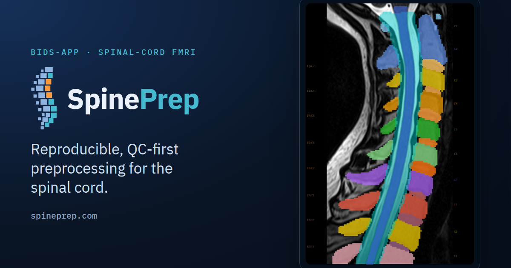
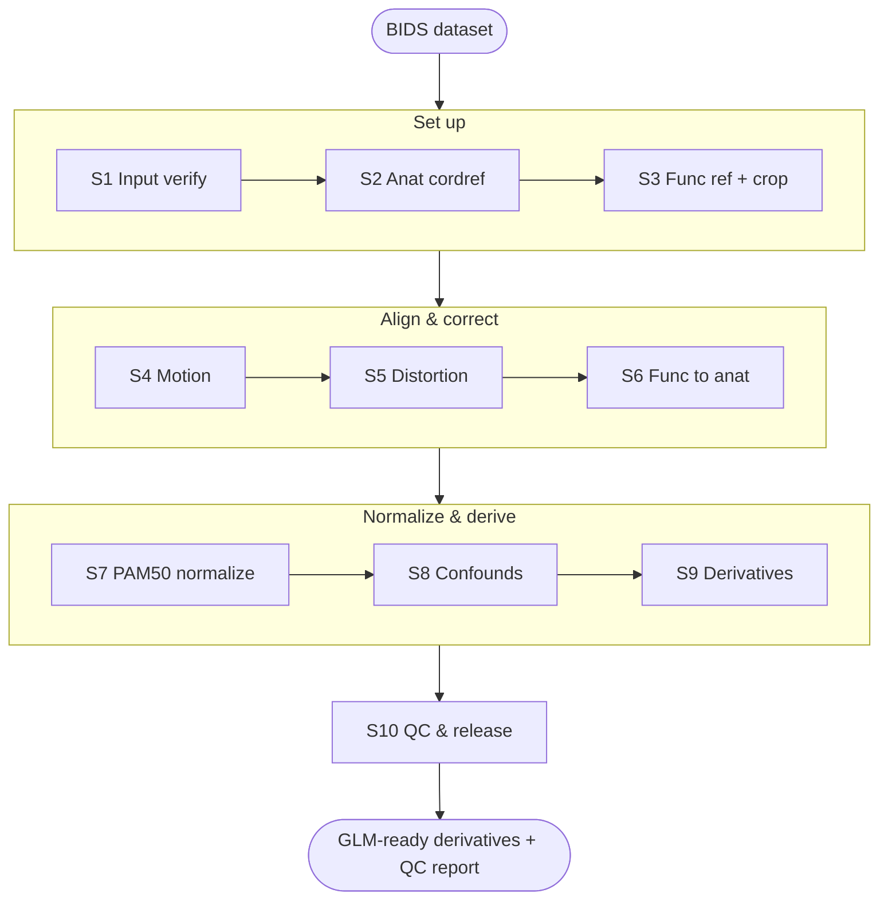
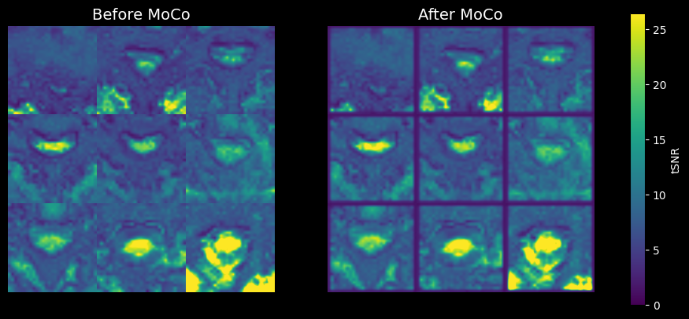

<p align="center">
  <a href="https://spineprep.com"></a>
</p>

<p align="center">
  <a href="https://github.com/SpinePrep/SpinePrep/actions/workflows/ci.yml"></a>
  <a href="https://bids-apps.neuroimaging.io/"></a>
  <a href="https://github.com/SpinePrep/SpinePrep/releases"></a>
  <a href="https://github.com/SpinePrep/SpinePrep/commits/main"></a>
  <a href="https://pypi.org/project/spineprep/"></a>
  <a href="https://pypi.org/project/spineprep/"></a>
  <a href="LICENSE"></a>
  <a href="https://pypi.org/project/spineprep/"></a>
  <a href="https://spineprep.com/"></a>
  <a href="https://neurostars.org/tag/spineprep"></a>
  <a href="https://doi.org/10.5281/zenodo.21294696"></a>
</p>

<p align="center">
  <strong>Reproducible, QC-first preprocessing for human spinal-cord fMRI.</strong><br>
  An open, containerised BIDS-App — a BIDS dataset in, GLM-ready derivatives and per-step quality control out.
</p>

---

SpinePrep automates the field's recommended cord-fMRI recipe end to end, with **one
step-local truth metric and one visual reportlet at every step**. It follows the
design of the established brain pipelines (fMRIPrep, MRIQC, SCT) and applies it to
a 5–7 mm structure that moves, distorts, and spans vertebral levels.

The scientific methods belong to the tools SpinePrep integrates — the
[Spinal Cord Toolbox](https://spinalcordtoolbox.com/), FSL, ANTs, and the PAM50
template. **SpinePrep's contribution is the integration, automation,
reproducibility, and standardised quality control around them**, not new algorithms.

> [!NOTE]
> SpinePrep is at **v26.1.0** and methods validation is **ongoing**. It has been
> developed and tested on cervical spinal-cord EPI-BOLD at 3 T across nine public
> and internal datasets; it runs outside that envelope but warns you. See the
> [validation page](https://spineprep.com/validation/) for current evidence and
> known limits.

## Pipeline



Each step measures itself in isolation (its own pass/warn/fail metric) and emits a
diagnostic reportlet, so a failure is attributable to the step that caused it.

`participant` runs S1 to S9 per subject; `group` runs S10. Paths are relative to the output
directory; `func/`, `anat/` and `figures/` sit under one of two folders. S2, S2B and S7 to S9 write to
`derivatives/spineprep/<dataset>/sub-<id>/[ses-<id>/]`; S3 to S6 write to
`derivatives/spineprep/sub-<id>/[ses-<id>/]`, without the dataset level. The final outputs (S9) are in the first.
Each step writes its QC record to `logs/<step>/<dataset>/qc.json` (S10: `logs/S10_qc_aggregation_and_release/qc.json`).

| Step | What it does | Input | Output | QC picture |
|---|---|---|---|---|
| S0 | Developer environment check; not run by the BIDS-App | runtime, images, PAM50 | `logs/S0_setup_qc.json` | none (check list) |
| S1 | Inventories and checks the BIDS dataset | BIDS dataset | `bids_inventory.json` | HTML: counts, subject-by-modality grid, checks |
| S2 | Anatomical cord reference, segmentation, labels, PAM50 registration | anat (S1) | `anat/` cordref, cord seg, labels; `xfm/` warps | montages, crop box, PAM50 overlay |
| S2B | Optional MP-PCA denoising of raw BOLD (off by default; a preset can turn it on; needs MRtrix3 `dwidenoise`) | raw BOLD (S1) | `denoise/<run_id>/desc-denoised_bold` | noise map, tSNR before/after, residual |
| S3 | Functional reference, outlier frames, crop to cord | BOLD (S1 or S2B), S2 ref | `runs/S3_func_init_and_crop/<run_id>/` | localization, frame metrics, crop box |
| S4 | Two-stage cord motion correction | S3 crop, ref, mask | `func/` `desc-mocoref_bold`, `moco_params.tsv` | motion traces, slice-wise shift, tSNR before/after |
| S5 | Distortion correction (topup, SyN or none) | S4 series, S2 ref, fieldmaps | `func/` `desc-undistorted_bold` | A-P displacement, cord Dice, before/after |
| S6 | Cord-driven BOLD-to-anatomy registration | S5 outputs, S2 ref | `func/` `from-bold_to-anat_xfm`, inverse, mean BOLD | BOLD on anatomy, cord Dice per slice |
| S7 | BOLD-to-PAM50 warps; PAM50 masks in native space | S6 and S2 warps | `func/` `from-bold_to-PAM50_xfm`, PAM50 masks | PAM50 cord on funcref, cord Dice per level |
| S8 | Confound table: motion, FD, DVARS, CSF, RETROICOR, cosine | S3-S7 outputs, physio | `func/` `desc-confounds_timeseries` | carpet, correlations, outliers, physio |
| S9 | Native-space preprocessed BOLD and tSNR (unsmoothed by default) | S5 series, S7 warp | `func/` `desc-preproc_bold`, tSNR maps and table | axial tSNR map, tSNR per level |
| S10 | Aggregates QC and writes release reports | all QC records | HTML reports, metrics index, receipt, `CITATION.cff` | HTML reports, coverage matrix, tSNR heatmap |

## Quality control is the validator

Every run produces self-contained HTML reports — the human eyeballs the figures;
the numbers quantify the call. One reportlet should tell you *what failed and why*.

<p align="center">
  
</p>

## Installation

### Container (recommended)

SpinePrep ships as a **build recipe**, not a prebuilt image — a deliberate choice.
The container installs FSL, which is free for academic/non-commercial use but
carries non-commercial licence terms. Building the image yourself (rather than us
redistributing one that bundles FSL) keeps SpinePrep's own Apache-2.0 distribution
unencumbered, and you obtain FSL directly under its own licence.

```bash
git clone https://github.com/SpinePrep/SpinePrep.git
cd SpinePrep
docker build -f Dockerfile.spineprep \
  --build-arg GIT_SHA=$(git rev-parse HEAD) \
  --build-arg GIT_DESCRIBE=$(git describe --always --tags) \
  -t spineprep:26.1.0 .
```

For HPC, convert the image to Apptainer — see the
[quickstart](https://spineprep.com/quickstart/).

### Local (advanced)

The Python orchestration layer is on PyPI, but the full pipeline also needs
**SCT, FSL, and ANTs** on your `PATH` (the container provides these):

```bash
pip install spineprep
```

## Quickstart

SpinePrep uses the standard BIDS-App interface:

```bash
# participant level: preprocess each subject
docker run --rm -v /path/to/bids:/bids:ro -v /path/to/out:/out \
  spineprep:26.1.0 /bids /out participant --participant-label sub-01

# group level: aggregate QC and write the release report
docker run --rm -v /path/to/bids:/bids:ro -v /path/to/out:/out \
  spineprep:26.1.0 /bids /out group
```

Add `--user "$(id -u):$(id -g)"` to `docker run` so the outputs belong to you rather than root.
If files in the BIDS folder are symbolic links to elsewhere, also mount that place, read-only, at the
same path inside the container, or the links will not resolve.

See the [documentation](https://spineprep.com/) for options, configuration, and the
full walkthrough.

## Settings and presets

Every step reads its settings from `policy/<step>.yaml`; each value there carries the
paper it comes from. A study that needs other values selects a **preset** instead of
editing those files: `policy/presets/<name>/` holds only the keys it changes, laid over the
defaults. The preset in use is recorded in the S10 reproducibility receipt.

```bash
docker run --rm -e SPINEPREP_PRESET=cospi -v /path/to/bids:/bids:ro -v /path/to/out:/out \
  spineprep:26.1.0 /bids /out participant --participant-label sub-01
```

Pass the same preset to the `group` level, so its receipt records it. The shipped preset `cospi`
turns S2B MP-PCA denoising on (MRtrix3 `dwidenoise`, included in the container), sets S5
distortion correction to `none`, and turns S9 smoothing on; see `policy/presets/cospi/README.md`.

| Variable | Effect |
|---|---|
| `SPINEPREP_PRESET` | name of a folder in `policy/presets/` (shipped: `cospi`) |
| `SPINEPREP_ONLY_SUBJECTS` | comma-separated subjects for S6-S9, to run several invocations side by side |
| `SPINEPREP_T2LINK_ROOT` | when S6 registers to a T2* and S2 to a T2w: a folder holding `sub-<id>/warp_T2star_to_T2w.nii.gz` and `sub-<id>/warp_T2w_to_T2star.nii.gz`, computed outside SpinePrep. In a container, mount the folder read-only and give its path inside the container |
| `SPINEPREP_SIGMA_MM` | S9 smoothing sigma in mm, R-L A-P S-I, e.g. `1,1,5` (set by `--smoothing-sigma-mm`); anything but three numbers stops S9 |

## What you get

- **BIDS-native** — a BIDS dataset in, BIDS-Derivatives out; no manual masking.
- **Cord-focused** — segmentation, motion, distortion and PAM50 normalization tuned
  for the cord, not adapted from brain defaults.
- **Readable QC** — one truth metric and one reportlet per step, plus subject- and
  group-level HTML reports with a reconciled attrition waterfall.
- **Reproducible** — deterministic runs, versioned policy, and a provenance receipt
  (tool + policy + git SHAs); a re-run reproduces the same numbers under the same
  tool versions.

## Documentation

Full documentation lives at **[spineprep.com](https://spineprep.com/)**:

- [Quickstart](https://spineprep.com/quickstart/) · [Install & use](https://spineprep.com/tutorial/)
- [Methods (S1–S10)](https://spineprep.com/methods/overview/) · [Validation](https://spineprep.com/validation/)
- [CLI](https://spineprep.com/reference/cli/) · [Configuration](https://spineprep.com/reference/config/) · [Cite](https://spineprep.com/cite/)

## Citation

If you use SpinePrep, please cite the software and the tools it builds on
(SCT, FSL, ANTs, PAM50) — the auto-generated methods boilerplate in each report
lists them, and [How to cite](https://spineprep.com/cite/) gives the references.

```bibtex
@software{spineprep,
  title   = {SpinePrep: a containerised BIDS-App for reproducible
             spinal-cord fMRI preprocessing},
  author  = {Sharifi, Kiomars},
  year    = {2026},
  version = {26.0.0},
  doi     = {10.5281/zenodo.21294696},
  url     = {https://spineprep.com}
}
```

GitHub's "Cite this repository" button reads
[`CITATION.cff`](CITATION.cff) and always gives the current form.

## Contributing

Contributions are welcome — see [CONTRIBUTING.md](CONTRIBUTING.md) and the
[Code of Conduct](CODE_OF_CONDUCT.md). For **usage questions**, please post on the
[NeuroStars `spineprep` tag](https://neurostars.org/tag/spineprep) rather than the
issue tracker, so answers stay searchable for the next person.

## Acknowledgements

SpinePrep builds directly on the [Spinal Cord Toolbox](https://spinalcordtoolbox.com/),
FSL, ANTs, and the PAM50 template, and follows the design philosophy of
[fMRIPrep](https://fmriprep.org/). We are grateful to those projects and their
communities.

## License

Apache-2.0 — see [LICENSE](LICENSE). SpinePrep integrates third-party tools under
their own licences; see [NOTICE](NOTICE).
